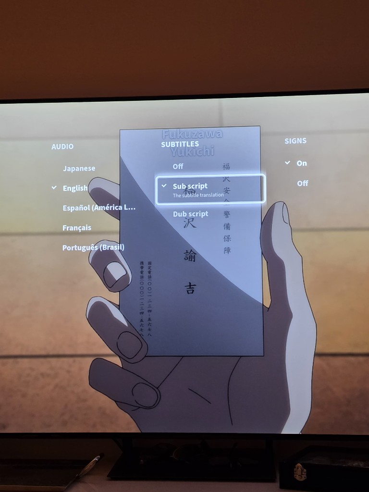

# Crunchyroll Tizen S90C

An unofficial Crunchyroll TV client fork tested on a 2023 Samsung S90C. It keeps
the original project's account, browsing and playback support while adding a
new TV interface and better subtitle control for dubbed playback.

This project is not affiliated with or endorsed by Crunchyroll or Samsung. It
does not bypass an account or subscription.

## Changes in this fork

- English dub playback with separate sign, dub-script and original-script
  controls when Crunchyroll provides those subtitle files
- Positioned ASS subtitle rendering for translated signs and on-screen text
- Reworked player controls, subtitle settings and remote navigation
- Larger TV typography, clearer focus states and smoother shelf movement
- Expanded search filters backed by Crunchyroll and public AniList metadata
- Optional local recommendation, favorite and watched-list files
- A lightweight bunny loading animation designed for TV hardware

Subtitle availability varies by series. If Crunchyroll no longer provides the
original English subtitle file, this client cannot recreate the missing signs.



## Tested hardware

- Samsung 65-inch S90C OLED, 2023
- Model QN65S90CDFXZA
- Tizen developer connection over TCP port 26101

Other model years need testing. Please open an issue with the model and firmware
version if you try it.

## Install on a recent Samsung TV

Read [the S90C sideloading guide](docs/S90C-SIDELOAD.md) before installing. It
covers the App Settings path that many older instructions omit, local IP
matching and the full power cycle that opened port 26101 on the tested S90C.

## Build and install

Install [Tizen Studio](https://developer.tizen.org/development/tizen-studio/download)
with the TV extension and Samsung certificate extension, then create an author
certificate and a distributor certificate for the TV.

```sh
npm install
npm run tizen-build
tizen package -t wgt -s <PROFILE-NAME> -- dist -o .
tizen install -n Crunchyroll.wgt -s <TV-IP>:26101 -- /path/to/crunchyroll-tizen-s90c
tizen run -s <TV-IP>:26101 -p qXuEoRvlCp.Crunchyroll
```

`PROFILE-NAME` is the Tizen security profile. It is not the TV IP address.

## Personal shelves

The following files are intentionally empty in the public repository:

- `server/data/neet-recommendations.json`
- `server/data/your-favorites.json`
- `server/data/watched-cr-ids.json`

They can be filled locally, but do not commit account names, viewing history or
private recommendations to a public fork.

## Project history

This is a fork of
[jhassan8/crunchyroll-tizen](https://github.com/jhassan8/crunchyroll-tizen).
The original project established the Tizen client, authentication and playback
support. This repository preserves its commit history and Apache-2.0 license.

Development on this fork was AI-assisted. I directed the design, tested each
build on the television and diagnosed the S90C-specific installation process.

## License

The application remains under the Apache License 2.0. Bundled Source Sans 3
font files are distributed under the SIL Open Font License 1.1 in
`css/fonts/SourceSans3-OFL.txt`.
